# StudySprint

**An exam study planner that fits your revision into the free time you actually have, and adjusts when life gets in the way.**


## Screenshots

| | Modules & free time | Weekly plan | Progress |
| --- | --- | --- | --- |
| **Light** | [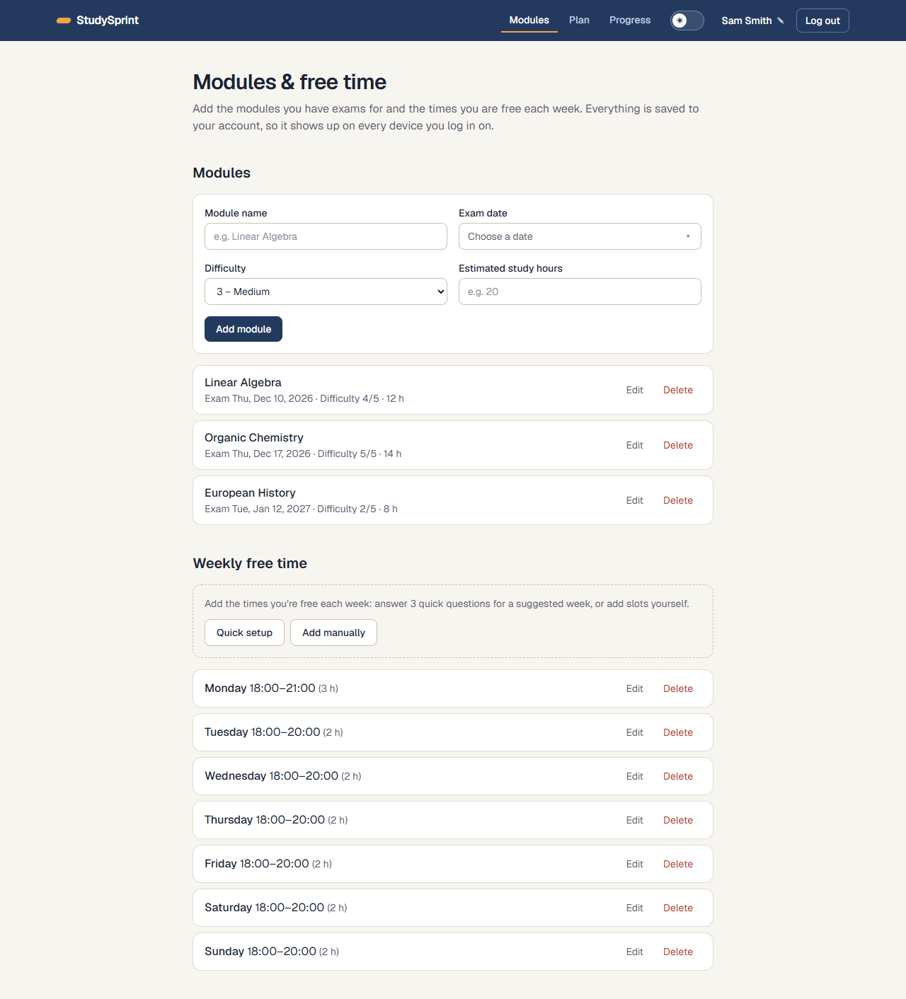](docs/screenshots/modules.png) | [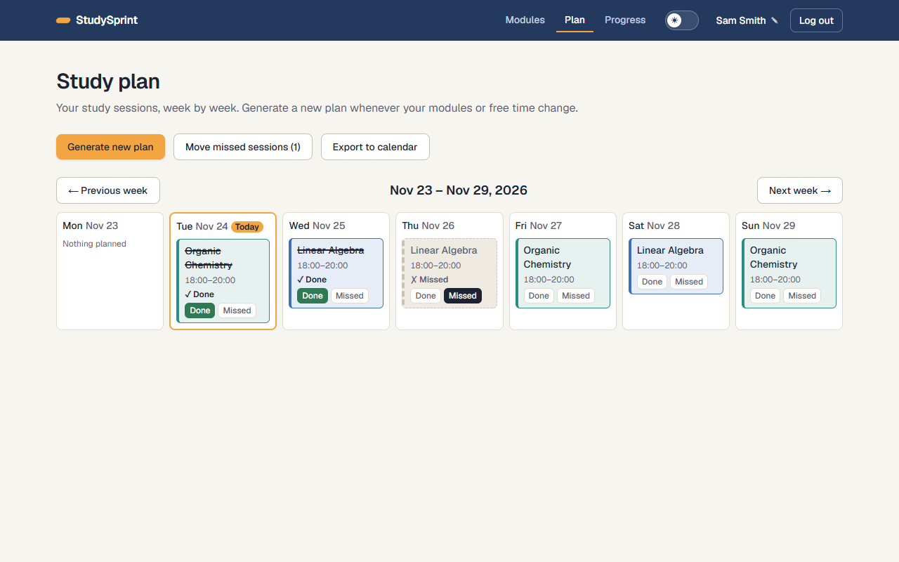](docs/screenshots/plan.png) | [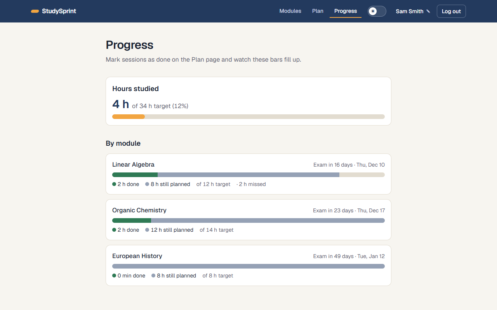](docs/screenshots/progress.png) |
| **Dark** | [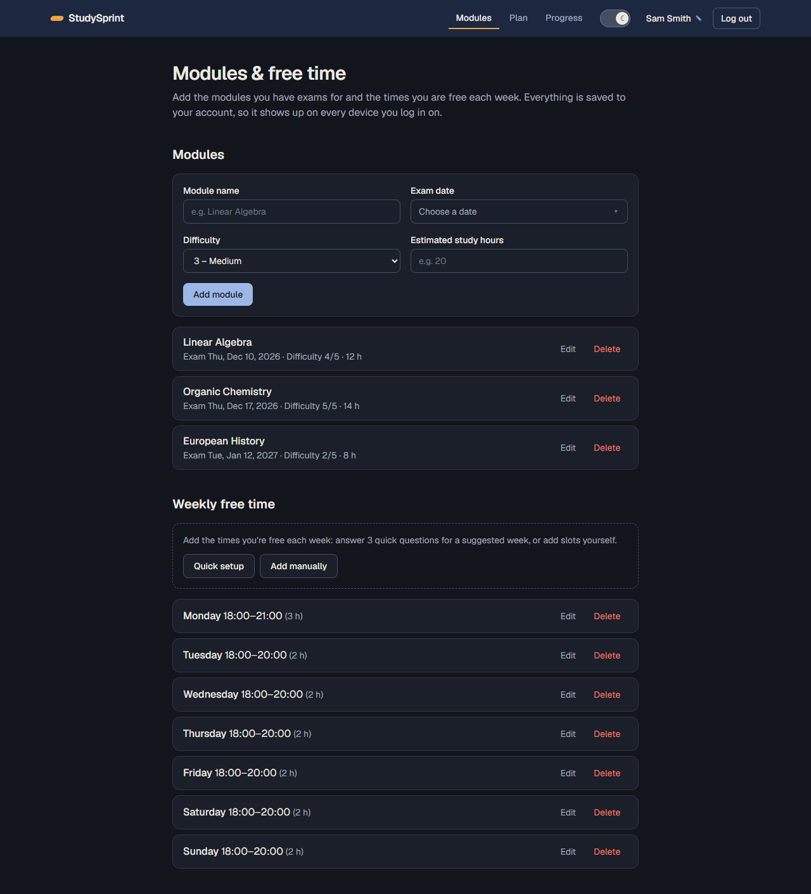](docs/screenshots/modules-dark.png) | [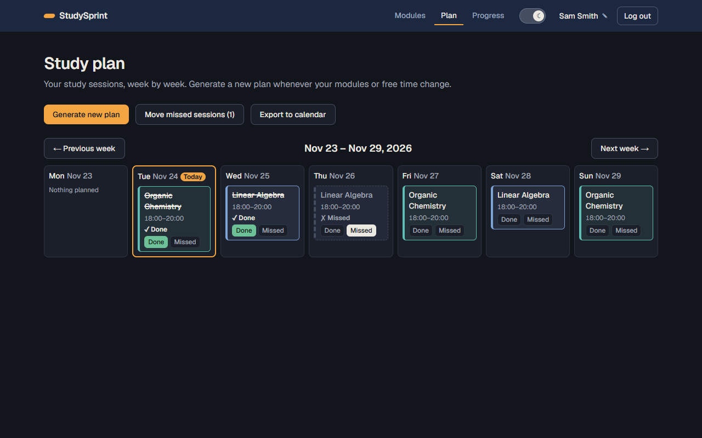](docs/screenshots/plan-dark.png) | [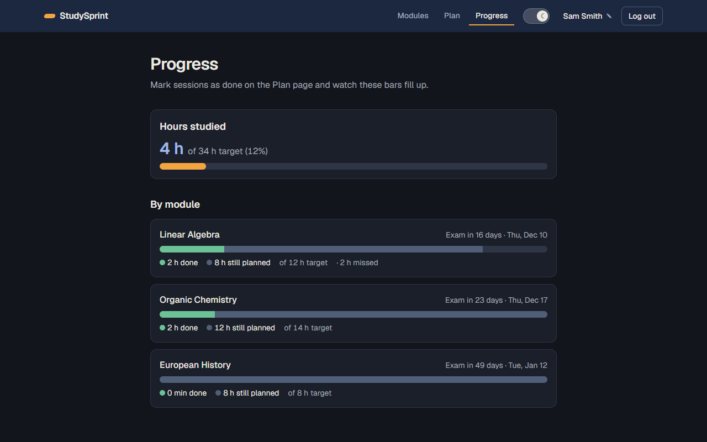](docs/screenshots/progress-dark.png) |

_Click a screenshot to see it full size. The switch next to the page links in the header changes between light and dark mode._

### More screens

| Home page | Create an account | Quick setup |
| --- | --- | --- |
| [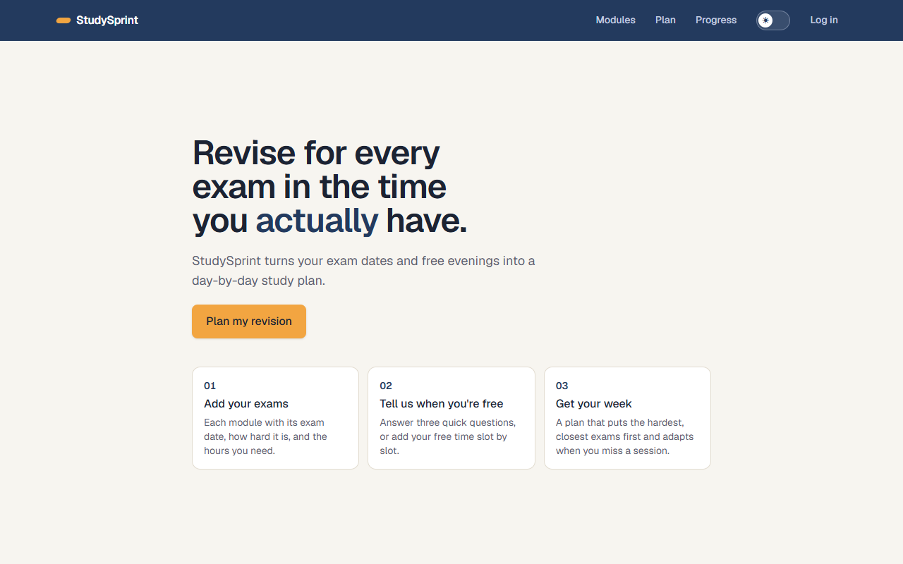](docs/screenshots/home.png) | [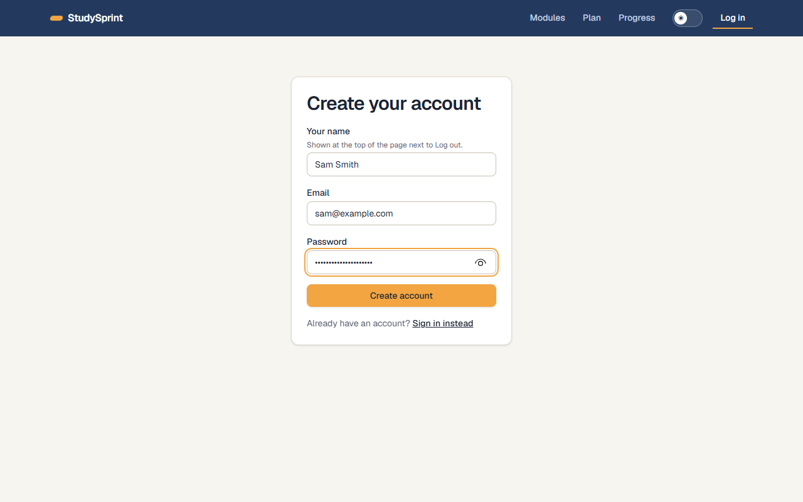](docs/screenshots/signup.png) | [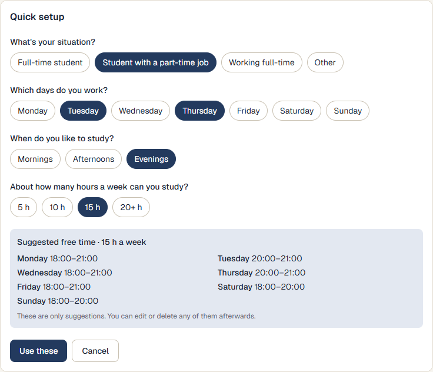](docs/screenshots/quick-setup.png) |

| Edit module pop-up | Change your name pop-up |
| --- | --- |
| [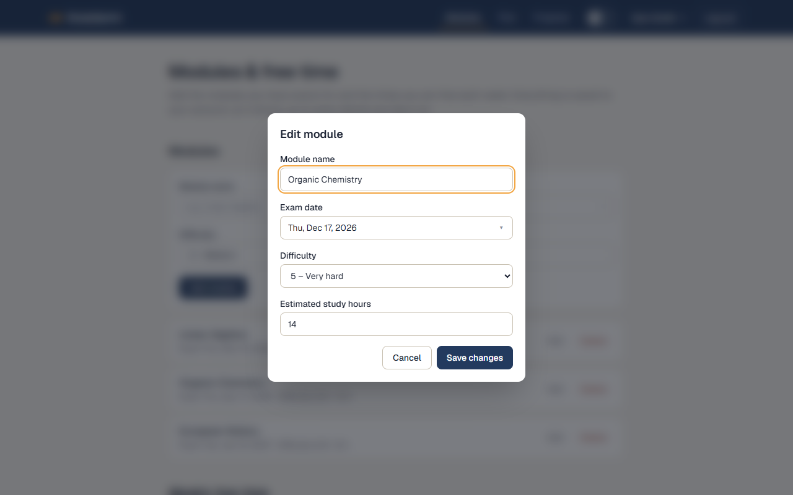](docs/screenshots/edit-module.png) | [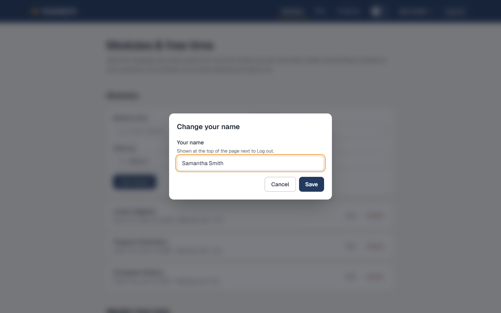](docs/screenshots/change-name.png) |

| Phone (light) | Phone (dark) |
| --- | --- |
| [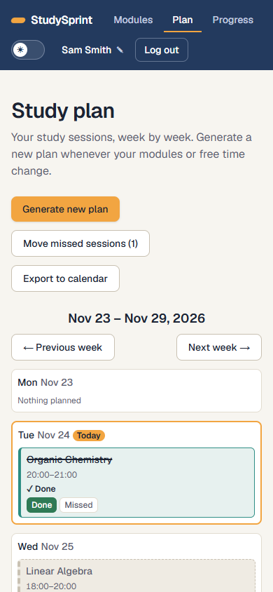](docs/screenshots/phone-plan.png) | [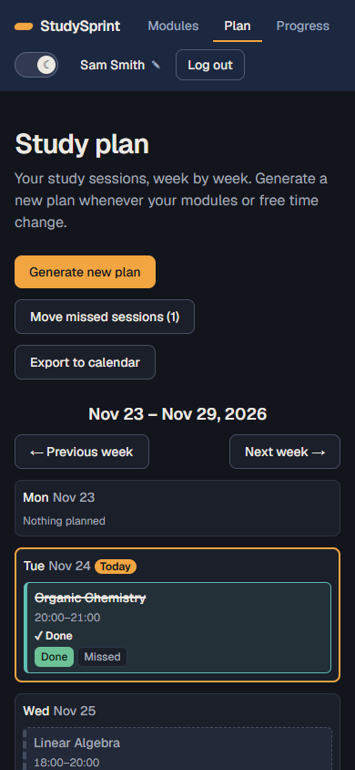](docs/screenshots/phone-plan-dark.png) |

## Features

- **Accounts:** sign up and sign in with email and password (Supabase Auth). `/modules`, `/plan` and `/progress` are only for logged-in users, and your data follows you to every device.
- **Your name:** sign-up asks for your name (letters from any language, spaces, dots, dashes and apostrophes, up to 40 characters), and it is shown in the header next to **Log out**.
- **Change your name:** click your name in the header (✎) to open a **Change your name** pop-up with your current name filled in. Type the new one and press **Save**: the header updates straight away and a message confirms it. Accounts made before names existed see **Add your name** instead, which opens the same pop-up. Invalid names get an error message, and if saving fails, the pop-up stays open with what you typed.
- **Modules:** add each subject with its exam date (calendar picker), difficulty (1–5) and how many hours you think you need. Edit a module in a pop-up; if you change its exam date, difficulty or hours after making a plan, the app suggests generating a new one. Deleting asks first and also removes the module's study sessions.
- **Weekly free time:** answer three quick questions for a suggested week, or add slots by hand with iPhone-style time wheels. Edit and delete happen in pop-ups, and deleting always asks first.
- **Automatic plan:** one click builds a day-by-day schedule up to every exam, shown as a Mon–Sun grid (a list on phones) with a colour per module and exam days highlighted.
- **Done / Missed:** mark each session. **Move missed sessions** finds new free time for missed study before the exam, without double-booking.
- **Progress:** hours studied against your target, a bar per module (done vs still planned) and days until each exam.
- **Calendar export:** download `studysprint-plan.ics` and import it into Google Calendar, Apple Calendar or Outlook.
- **Warnings:** the plan tells you when there isn't enough free time before an exam.
- **Confirmation messages:** a short message in the corner confirms every save (module added, session marked done, name changed…). If a save fails, you get an error message instead.
- **Light and dark mode:** a switch in the header (☀ / ☾) changes between light and dark mode, and your choice is remembered in this browser. Until you use it, the app follows your device's setting. A tiny script picks the right colours before the page appears, so it never flashes white.
- **Phones:** every page fits a phone screen, with the plan shown as a list instead of a week grid.
- **Accessible:** everything works with a keyboard, pop-ups keep focus inside and return it when closed, and every page was checked with the [axe](https://github.com/dequelabs/axe-core) accessibility checker, in light and dark mode.
- **Security:** row level security in the database (see below), plus security headers on every page that, for example, stop other websites from showing the app inside a frame.

## Tech stack

| Part | Tool |
| --- | --- |
| Framework | [Next.js 16](https://nextjs.org) (App Router, Turbopack), React 19, TypeScript |
| Styling | Tailwind CSS 4 |
| Database & login | [Supabase](https://supabase.com) (Postgres, Auth, row level security) via `@supabase/ssr` |
| Tests | Vitest + React Testing Library (jsdom) |
| Quality | ESLint, `tsc --noEmit`, GitHub Actions CI |

## How the scheduling algorithm works

The planner lives in [`src/lib/scheduler.ts`](src/lib/scheduler.ts). It is a set of **pure functions**: they read no clock and no database, so the same input always gives the same plan, which makes them easy to test.

### `generateSchedule(modules, availability, startDate)`

1. **Set aside modules that can't be planned:** an exam that has passed, an exam on the start date, or an invalid date. Each one produces a warning.
2. **Turn weekly free time into blocks.** Overlapping slots on the same day are merged, then cut into **blocks of at most 2 hours**.
3. **Walk forward day by day**, from the start date to the day before the last exam. For each block, choose the module with the highest priority:

   ```
   priority = difficulty × hours still needed ÷ days until the exam
   ```

   Hard modules, modules with lots left to do and modules with close exams all rise to the top. On a tie, the earlier exam wins. If the chosen module needs less than the whole block, the rest of the block goes to the next-best module.
4. **Respect the rules:**
   - never study on or after a module's exam day;
   - **the day before an exam belongs to that exam only**.
5. **Warn** about every module whose hours didn't fit, e.g. _"Not enough free time for History: 12 hours couldn't be scheduled before its exam on 2026-11-27."_

### `rescheduleMissed(sessions, modules, availability, today)`

This moves the time of sessions you marked **Missed**. It returns only the new sessions, so your history stays as it was. It follows all of the rules above, plus:

- It starts **tomorrow**, because today's free time may already be over.
- It only uses free time that **no other session uses** (planned, done or missed). So it never double-books, and never puts the time back into the slot that was missed.
- Each new session records `movedFrom` (the id of the missed session it replaces), so **the same missed session is never moved twice**.
- Missed time for an exam that has already passed, or is today, isn't moved, and you get a warning instead.

## Database design

The schema is in [`supabase/schema.sql`](supabase/schema.sql). There are three tables, one per type in [`src/types.ts`](src/types.ts):

| Table | Holds | Key columns |
| --- | --- | --- |
| `modules` | Subjects with an exam | `name`, `exam_date`, `difficulty` (1–5), `estimated_hours` (0 < h ≤ 1000) |
| `availability` | Weekly free time | `day_of_week` (0 = Sunday … 6), `start_time`, `end_time` (`HH:MM`, end > start) |
| `study_sessions` | The plan | `module_id`, `date`, `start_time`, `end_time`, `status` (`planned`/`done`/`missed`), `moved_from` |

- **Every row has `user_id uuid default auth.uid()`.** The database fills in the logged-in user, so the app never sends it.
- **The primary key of each table is `(user_id, id)`.** Ids only need to be unique per user.
- **CHECK constraints** mirror the app's validation, so bad data is refused even if it doesn't come from the app.
- **Each session must belong to one of your own modules**, through a foreign key on `(user_id, module_id)`. Deleting a module deletes its sessions (`on delete cascade`).
- The app's camelCase types are translated to and from the snake_case columns in one place: [`src/lib/supabase/mappers.ts`](src/lib/supabase/mappers.ts).

### Row level security (RLS)

RLS is switched on for all three tables. Each table has four policies (select, insert, update, delete) that only allow rows where `user_id = auth.uid()`, and only for logged-in users.

The publishable key in the browser is therefore safe to share: the database itself refuses to show or change anyone else's rows, even if someone talks to Supabase directly.

### Your name

Your name isn't in a table. It is saved with your login, in Supabase Auth's **user metadata** (`name`), through `signUp` and `updateName` in [`src/lib/auth.ts`](src/lib/auth.ts). People can change their own metadata, so the name is only ever used for display, never to decide who may see what.

### Sessions and page protection

[`src/proxy.ts`](src/proxy.ts) (Next.js 16's new name for `middleware.ts`) runs before every page:

- It refreshes the Supabase login session, which is stored in cookies.
- It redirects logged-out visitors of private pages to `/login?next=…`.

Client and server Supabase helpers live in [`src/lib/supabase/`](src/lib/supabase).

## Local setup

You need **Node.js 22** or newer and a free [Supabase](https://supabase.com) project.

1. **Get the code and install:**

   ```bash
   git clone https://github.com/YaSsien27/studysprint.git
   cd studysprint
   npm install
   ```

2. **Add your Supabase keys.** Copy the example file:

   ```bash
   cp .env.example .env.local
   ```

   Then fill in both values from your Supabase dashboard (**Project Settings → API**). `.env.local` is ignored by Git, so it is never committed.

   ```
   NEXT_PUBLIC_SUPABASE_URL=https://your-project.supabase.co
   NEXT_PUBLIC_SUPABASE_PUBLISHABLE_KEY=sb_publishable_...
   ```

3. **Create the tables.** In the Supabase dashboard, open **SQL Editor → New query**, paste all of [`supabase/schema.sql`](supabase/schema.sql) and click **Run**. It is safe to run again later.

4. **Allow the email confirmation link** (only if **Confirm email** is on, under **Authentication → Sign In / Providers → Email**). Under **Authentication → URL Configuration**, add `http://localhost:3000/auth/callback` to the **Redirect URLs**.

5. **Start the app:**

   ```bash
   npm run dev
   ```

   Open <http://localhost:3000> and create an account.

## Running the tests

```bash
npm test             # run all tests once
npm run test:watch   # re-run tests as you save files
npm run lint         # ESLint
npx tsc --noEmit     # type-check
npm run build        # check that the app builds
```

- **The tests never touch your real database.** [`vitest.setup.ts`](vitest.setup.ts) swaps the Supabase data layer for an in-memory fake ([`src/test/fakeBackend.ts`](src/test/fakeBackend.ts)).
- **162 tests in 25 files**, all passing.
- **What's covered:**
  - the scheduler and `rescheduleMissed`: every rule, plus past exams;
  - the `.ics` export: CRLF line endings, escaping, line folding, missed sessions left out;
  - the form checks for modules, free time and names;
  - adding, editing and deleting modules and free time, and the Quick setup questions;
  - the confirmation messages, including the one shown after a page reload;
  - the database mappers, the login form, redirects and the security headers;
  - the light/dark switch and the script that picks the theme before the page appears;
  - the name in the header and the **Change your name** pop-up (saving, invalid names, a failed save, Cancel);
  - every page.

**CI:** [`.github/workflows/ci.yml`](.github/workflows/ci.yml) runs on every push to `main` and every pull request: `npm ci`, lint, type-check, tests and build. It uses placeholder Supabase values, so no real keys are needed on GitHub.

## Future ideas

- **Smarter catching up:** count done hours when generating a new plan, so regenerating keeps your progress instead of replacing it.
- **Exams in the calendar export:** add each exam as an all-day event in the `.ics` file.
- **A live calendar feed:** a subscribe link that updates by itself, instead of a one-time download.
- **Reminders:** an email or push notification before each session.
- **Overlapping free time:** warn when two slots overlap.
- **Preferred study times and breaks:** for example, no more than 4 hours a day, or a 15-minute break between blocks.
- **Saved warnings:** keep plan warnings in the database too, so they're still there after a reload.
- **Statistics:** a streak counter and hours studied per week.
- **Sharing:** read-only study groups that can see each other's progress.
